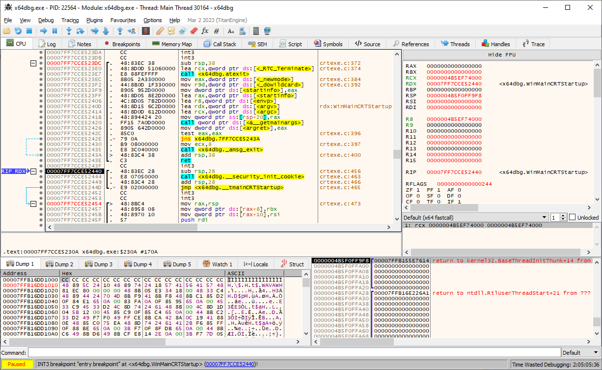
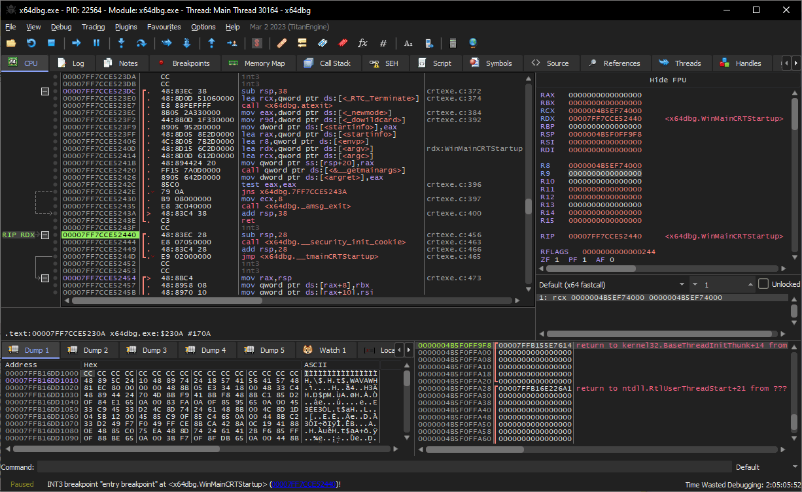
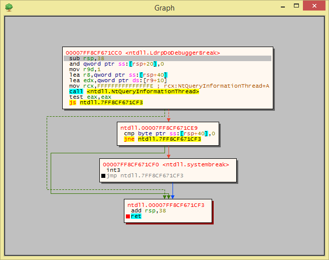
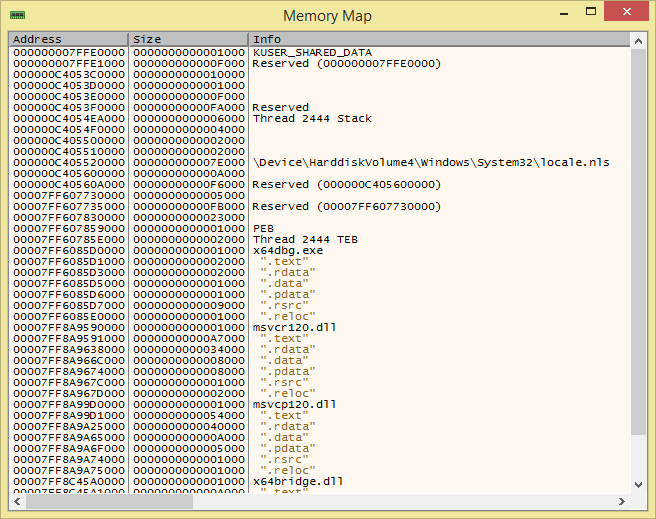

# x64dbg

  

    

An open-source binary debugger for Windows, aimed at malware analysis and reverse engineering of executables you do not have the source code for. There are many features available, as well as a comprehensive [plugin system](https://plugins.x64dbg.com) to add your own. You can find more information on the [blog](https://x64dbg.com/blog)!

## Screenshots

|  |  |
| :--: | :--: |

## Installation & Usage

1. Download a snapshot from [GitHub](https://github.com/x64dbg/x64dbg/releases) or [SourceForge](https://sourceforge.net/projects/x64dbg/files/snapshots) and extract it to a location your user has write access to.
2. _Optionally_ use `x96dbg.exe` to register a shell extension and add shortcuts to your desktop.
3. You can now run `x32\x32dbg.exe` if you want to debug a 32-bit executable or `x64\x64dbg.exe` to debug a 64-bit executable! If you are unsure, you can always run `x96dbg.exe` and choose your architecture there.

You can also [compile](https://github.com/x64dbg/x64dbg/wiki/Compiling-the-whole-project) x64dbg yourself with a few easy steps!

## Sponsors

  

  [**Warp, built for coding with multiple AI agents**](https://sponsors.x64dbg.com/warp)

 

## Contributing

This is a community effort, and we accept pull requests! See the [CONTRIBUTING](.github/CONTRIBUTING.md) document for more information. If you have any questions, you can always [contact us](https://x64dbg.com/#contact) or open an [issue](https://github.com/x64dbg/x64dbg/issues). You can take a look at the [good first issues](https://easy.x64dbg.com/) to get started.

## Credits

- Debugger core by [TitanEngine Community Edition](https://github.com/x64dbg/TitanEngine)
- Disassembly powered by [Zydis](https://zydis.re)
- Assembly powered by [XEDParse](https://github.com/x64dbg/XEDParse) and [asmjit](https://github.com/asmjit)
- Import reconstruction powered by [Scylla](https://github.com/NtQuery/Scylla)
- JSON powered by [Jansson](https://www.digip.org/jansson)
- Database compression powered by [lz4](https://bitbucket.org/mrexodia/lz4)
- Bug icon by [VisualPharm](https://www.visualpharm.com)
- Interface icons by [Fugue](https://p.yusukekamiyamane.com)
- Website by [tr4ceflow](https://tr4ceflow.com)

## Developers

- [mrexodia](https://mrexodia.github.io)
- Sigma
- [tr4ceflow](https://blog.tr4ceflow.com)
- [Dreg](https://www.fr33project.org)
- [Nukem](https://github.com/Nukem9)
- [Herz3h](https://github.com/Herz3h)
- [torusrxxx](https://github.com/torusrxxx)

## Code contributions

You can find an exhaustive list of GitHub contributors [here](https://github.com/x64dbg/x64dbg/graphs/contributors).

## Special Thanks

- Sigma for developing the initial GUI
- All the donators!
- Everybody who adds issues!
- People I forgot to add to this list
- [Writers of the blog](https://x64dbg.com/blog/2016/07/09/Looking-for-writers.html)!
- [EXETools community](https://forum.exetools.com)
- [Tuts4You community](https://forum.tuts4you.com)
- [ReSharper](https://www.jetbrains.com/resharper)
- [Coverity](https://www.coverity.com)
- acidflash
- cyberbob
- cypher
- Teddy Rogers
- TEAM DVT
- DMichael
- Artic
- ahmadmansoor
- \_pusher\_
- firelegend
- [kao](https://lifeinhex.com)
- sstrato
- [kobalicek](https://github.com/kobalicek)
- [athre0z](https://github.com/athre0z)
- [ZehMatt](https://github.com/ZehMatt)
- [mrfearless](https://twitter.com/fearless0)
- [JustMagic](https://github.com/JustasMasiulis)

Without the help of many people and other open-source projects, it would not have been possible to make x64dbg what it is today. Thank you!

## Historical Donors

Before fully transitioning to [GitHub Sponsors](https://github.com/sponsors/mrexodia), this project received donations through BountySource. The original donation terms included an optional website link for donors who requested one at the time of donation. Links marked below reflect those requests. BountySource has since been shut down, so these records are reconstructed by hand. If you donated during this period and your username/amount is missing or incorrect, please reach out.

|Username|Amount|Date||Username|Amount|Date|
|-|-|-|-|-|-|-|
|sghctoma|$50|2015-04-19||dfrunza|$20|2017-01-30|
|overflow|$50|2015-04-25||ham3di|$100|2017-02-01|
|jl2id|$15|2015-04-29||johnny5|$5|2017-02-19|
|cypherpunk|$50|2015-05-02||David-Reguera-Garcia-Dreg|$90|2017-02-26|
|Aciid|$50|2015-05-05||[Alexandro Sanchez Bach](https://phi.nz)|-|2017-03-02|
|PI32|$15|2015-05-09||(unknown)|$6|2017-03-11|
|darkvapeur|$8|2015-05-21||fred26|$50|2017-04-08|
|fearless|$5|2015-05-24||gatesbillou|$20|2017-04-15|
|0x90|$10|2015-05-31||David-Reguera-Garcia-Dreg|$10|2017-04-24|
|acidflash|$50|2015-06-03||Adir|$20|2017-05-03|
|VackerSimon|$10|2015-06-14||ferbeb|$10|2017-05-17|
|Artic|$10|2015-06-29||(unknown)|$16|2017-06-04|
|[crystalidea](https://www.crystalidea.com/uninstall-tool)|$24|2015-07-10||androsa|$20|2017-06-11|
|jl2id|$10|2015-08-13||robersor|$25|2017-07-05|
|[PELock](https://pelock.com)|$115|2015-08-26||DDSTrainers|$10|2017-07-15|
|[tslater2006](https://github.com/tslater2006)|$20|2015-09-04||blaquee|$20|2017-08-27|
|Exidous|$20|2015-09-04||SmilingWolf|$15|2017-09-26|
|lupier|$40|2015-09-08||Alexander H.|$150|2017-10-11|
|Stef|$10|2015-09-15||gatesbillou|$25|2017-10-14|
|[d3v1l401](https://d3vsite.org)|$5|2015-10-06||t4rmo|$5|2017-10-18|
|Artur|$20|2015-10-24||joelcornu|$5|2017-10-27|
|RoBa|$100|2015-11-18||Adir|$35|2017-11-02|
|mr.tuna7331|-|2015-12-15||(unknown)|$10|2017-11-11|
|lupier|$90|2016-01-12||xdeng|$10|2018-01-04|
|fvrmatteo|$10|2016-01-21||v-p-b|$50|2018-03-21|
|willi.neu9|$10|2016-01-30||EmptyBrain|$50|2018-03-30|
|rithien|$100|2016-02-19||[mentebinaria](https://www.mentebinaria.com.br/)|$19|2018-04-12|
|ey|$20|2016-02-26||Mauro Bollini|$50|2018-06-07|
|clockwork|$10|2016-03-06||gatesbillou|$15|2018-06-17|
|codespy|$5|2016-03-23||Kirbiflint|$3|2018-06-22|
|test|$100|2016-03-28||Chisato Rokumiya|$20|2018-09-20|
|RomanGol|$10|2016-03-28||pengchang|$100|2018-10-24|
|fearless|$10|2016-04-24||younsunmin|$5|2018-11-18|
|Jack|$5|2016-05-17||EmptyBrain|$50|2018-12-27|
|willi.neu9|$30|2016-05-26||Yim|$10|2019-01-13|
|gatesbillou|$20|2016-06-02||[OALabs](https://www.youtube.com/c/OALabs)|-|2019-01-27|
|AGI|$155|2016-06-16||Lixinist|$10|2019-04-15|
|lupier|$100|2016-06-24||bloodmc|$50|2019-04-29|
|0x90|$50|2016-07-19||(unknown)|$20|2019-05-24|
|tr4nc3|$15|2016-07-31||masacate|$10|2019-07-10|
|MikeGuidry|$2500|2016-07-31||User Manuals|$5|2020-01-20|
|Alexander H.|$150|2016-09-09||Jim Conyngham|$50|2020-03-23|
|darkvapeur|$10|2016-10-04||Danya|$5|2020-06-08|
|h907308901|$5|2016-10-06||RooT|$160|2020-07-22|
|Adir|$20|2016-10-24||jadakiss9018|$2|2020-09-11|
|NicoG|$100|2016-10-27||samsonpianofingers|$15|2020-09-14|
|Angie|$150|2016-11-03||tpericin|$1337|2020-10-09|
|hulucc|$20|2016-12-02||nikkej|$100|2020-10-22|
|napcode|$10|2016-12-05||kha1ifaa|$10|2021-01-04|
|TechLord|-|2016-12-26||rikaardhosein|$20|2021-09-08|
|ayylmao5|$5|2017-01-01||Lukas21|$50|2021-09-15|
|affelwafro|$10|2017-01-03||Flavio Nardiello|$30|2021-12-01|
|FS|$40|2017-01-15||stevemk14ebr|$1000|2021-12-03|
|EmptyBrain|$50|2017-01-27||[ethical.blue](https://ethical.blue)|$19|2022-05-14|

_To all our early supporters: thank you for believing in this project before it became what it is today!_
